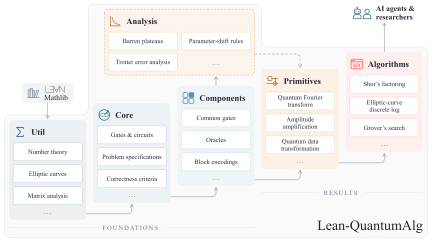

# Lean-QuantumAlg

<p align="center">
  <a href="https://github.com/leanprover/lean4/releases/tag/v4.33.1"></a>
  <a href="https://github.com/leanprover-community/mathlib4/releases/tag/v4.33.1"></a>
  <a href="LICENSE"></a>
  <br>
  <a href="https://arxiv.org/abs/2607.12981"></a>
  <a href="https://arxiv.org/abs/2607.14082"></a>
</p>

Lean-QuantumAlg is a Lean 4 library for formally verified quantum algorithms.

<p align="center">
  <picture>
    <source media="(prefers-color-scheme: dark)" srcset=".github/architecture-dark.svg">
    <source media="(prefers-color-scheme: light)" srcset=".github/architecture-light.svg">
    
  </picture>
</p>

## What's Lean-QuantumAlg?

Lean-QuantumAlg is a Lean 4 framework built on mathlib for AI agents to verify
quantum algorithms. It derives probabilities, final states and resource use
from one execution in an explicit model.

### Aims

- Bind correctness, borrowed-state restoration and resource bounds to one execution.
- Make specifications and execution models explicit for human review.
- Provide reusable, source-backed components following mathlib conventions.

### Cite this repository

If you use the quantum machine learning or quantum neural network formalizations in Lean-QuantumAlg, please cite:

```bibtex
@misc{jing2026agentic,
      title={An Agentic Formalization for Certified Quantum Neural Network Design},
      author={Mingrui Jing and Lei Zhang and Yusheng Zhao and Hongshun Yao and Xin Wang},
      year={2026},
      eprint={2607.12981},
      archivePrefix={arXiv},
      primaryClass={quant-ph},
      url={https://arxiv.org/abs/2607.12981},
}
```

If you use Shor's algorithm, the RSA-2048 or P-256 developments, or broader quantum cryptanalysis formalizations in Lean-QuantumAlg, please cite:

```bibtex
@misc{zhang2026building,
      title={Building Shor's Algorithm in Lean: An Agentic Formalization of Quantum Attacks on RSA-2048 and P-256},
      author={Lei Zhang and Yusheng Zhao and Hongshun Yao and Xin Wang},
      year={2026},
      eprint={2607.14082},
      archivePrefix={arXiv},
      primaryClass={quant-ph},
      url={https://arxiv.org/abs/2607.14082},
}
```

## Using Lean-QuantumAlg in your project

To add Lean-QuantumAlg as a dependency to a Lake project, add the following to
your `lakefile.toml`:

```toml
[[require]]
name = "QuantumAlg"
git = "https://github.com/QudeLeap/Lean-QuantumAlg.git"
rev = "3.4.0"
```

Starting with 3.4.0, Linux x86_64 releases include a precompiled library cache.
For a fresh dependency build, Lake fetches the matching cache automatically
and falls back to building from source if it is unavailable.

Use Lean `v4.33.1`. Then import either the aggregate module or a focused module:

```lean
import QuantumAlg
import QuantumAlg.Algorithms.Grover
import QuantumAlg.Algorithms.QPE
import QuantumAlg.Primitives.QFT
```

In a checkout of a release tag on Linux x86_64, fetch the Mathlib and library caches:

```bash
lake exe cache get
lake build :release
```

For a source build, including on other platforms, use `lake build` in place of
`lake build :release`.

For theorem discovery, browse the [public theorem catalog](https://qudeleap.github.io/Lean-QuantumAlg/)
or start from [`QuantumAlg.lean`](QuantumAlg.lean).
Lean docstrings cite the source references using keys resolved by
`REFERENCES.json`.

## Quantum machine learning

Lean-QuantumAlg exposes two overlapping views of quantum machine learning:
expressivity, and trainability with Lie-algebraic simulation.

**Expressivity.** Trigonometric polynomials and QSP/QSVT provide the polynomial
transformation substrate, followed by parameter-shift rules, quantum kernels,
and QFIM-based capacity bounds. Verified highlights include:

- [Generalized parameter-shift rule](https://qudeleap.github.io/Lean-QuantumAlg/theorems/generalized-parameter-shift-rule/)
  gives exact first and second derivatives for variational costs with equidistant
  integer frequencies; Lean:
  [`QuantumAlg.GeneralizedParamShift.quantumMain`](QuantumAlg/Analysis/GeneralizedParameterShift/Quantum.lean).
- [`QuantumAlg.QuantumKernel.main`](QuantumAlg/Primitives/QKernel/Fidelity.lean),
  proving that every finite fidelity-kernel Gram matrix is positive semidefinite.
- [`QuantumAlg.qfim_rank_le_dlaDim`](QuantumAlg/Analysis/QNN/Overparam/QuantumFisherRank.lean)
  and [`QuantumAlg.QFIMOverparam.main`](QuantumAlg/Analysis/QNN/Overparam/OverparamQFIM.lean),
  giving a dynamical-Lie-algebra rank bound and a non-vacuous `su(2)` QFIM onset.

**Trainability.** The main results connect explicit no-barren-plateau families,
Lie-algebraic simulation, and exact loss reconstruction:

- [Locality forbids the barren plateau](https://qudeleap.github.io/Lean-QuantumAlg/theorems/locality-no-barren-plateau/)
  gives a genuine product-Clifford local family with constant variance;
  Lean: [`QuantumAlg.localObs_not_hasBarrenPlateau`](QuantumAlg/Analysis/QNN/Algebras/SingleQubitDLA.lean).
- [g-sim transfer-matrix coordinate propagation](https://qudeleap.github.io/Lean-QuantumAlg/theorems/gsim-transfer-matrix/)
  evolves observables in the `dim(g)`-dimensional Lie-algebra coordinate space;
  Lean: [`QuantumAlg.gsimEvolved_coords`](QuantumAlg/Analysis/QNN/Simulation/GSim.lean).
- [Lie-algebraic loss reconstruction](https://qudeleap.github.io/Lean-QuantumAlg/theorems/gsim-correctness/)
  reconstructs the loss exactly from `dim(g)` quantum data;
  Lean: [`QuantumAlg.gsim_loss_reconstruction_ansatz`](QuantumAlg/Analysis/QNN/Simulation/GSim.lean).

Start from the focused public navigation modules:

```lean
import QuantumAlg.Analysis.QNN.Expressivity
import QuantumAlg.Analysis.QNN.Trainability
import QuantumAlg.Primitives.QML
```

Bibliographic sources are indexed in [`REFERENCES.json`](REFERENCES.json).

## Cryptanalysis

Lean-QuantumAlg formalizes quantum algorithms for integer factoring and
finite-cyclic discrete logarithms, including RSA-2048 and P-256. Each algorithm endpoint
states an independent problem and proves that an algorithm solves it under
an explicit execution model. Correctness, borrowed-state restoration and
logical-resource bounds refer to the same execution, with the input conditions
and success guarantees stated in the theorem's specification.

Verified highlights include:

- [Order finding](https://qudeleap.github.io/Lean-QuantumAlg/theorems/order-finding/)
  and its [exact dyadic specialization](https://qudeleap.github.io/Lean-QuantumAlg/theorems/order-finding-exact/)
  connect QPE output to classical order recovery, while the
  [modular-multiplication eigenstructure](https://qudeleap.github.io/Lean-QuantumAlg/theorems/modular-multiplication-eigenstructure/)
  fixes the spectral convention used by the circuit endpoint; Lean:
  [`QuantumAlg.OrderFinding.ShorSourceJoint.SourceNativeEndpoint.Canonical.main`](QuantumAlg/Algorithms/OrderFinding/General/NativeEndpoint/Canonical.lean),
  [`QuantumAlg.OrderFinding.Exact.NativeEndpoint.Canonical.main`](QuantumAlg/Algorithms/OrderFinding/Exact/Native/Canonical.lean), and
  [`QuantumAlg.OrderFinding.ResidueRegisterEigenstructure.main`](QuantumAlg/Algorithms/OrderFinding/Eigenstructure.lean).
- [Shor-style factoring](https://qudeleap.github.io/Lean-QuantumAlg/theorems/rsa-factorization-shor/)
  and [Ekera-Hastad-style factoring](https://qudeleap.github.io/Lean-QuantumAlg/theorems/rsa-factorization-ekera-hastad/)
  provide complete solvers with their respective success and resource guarantees; Lean:
  [`QuantumAlg.Factoring.ShorStyle.RealTarget.main`](QuantumAlg/Algorithms/Factoring/ShorStyle/Real.lean)
  and [`QuantumAlg.Factoring.EkeraHastadStyle.main`](QuantumAlg/Algorithms/Factoring/EkeraHastadStyle.lean).
- [RSA-2048 logical-resource estimate](https://qudeleap.github.io/Lean-QuantumAlg/theorems/rsa-2048-logical-resource-estimate/)
  bounds the native gates, space and quantum time of a complete factoring algorithm;
  Lean: [`QuantumAlg.Factoring.RSA2048.main`](QuantumAlg/Algorithms/Factoring/RSA2048.lean).
- [Finite-cyclic discrete logarithms](https://qudeleap.github.io/Lean-QuantumAlg/theorems/finite-cyclic-discrete-logarithms/)
  combine quantum sampling and classical recovery with explicit success and resource bounds;
  Lean: [`QuantumAlg.FiniteCyclicDLP.BinaryEndpoint.main`](QuantumAlg/Algorithms/FiniteCyclicDLP/Binary/Endpoint.lean).
- [P-256 logical-resource estimate](https://qudeleap.github.io/Lean-QuantumAlg/theorems/p256-logical-resource-estimate/)
  bounds a complete elliptic-curve discrete-logarithm algorithm, including repeated
  sampling and classical recovery; Lean:
  [`QuantumAlg.EllipticCurve.P256LogicalResources.main`](QuantumAlg/Algorithms/EllipticCurve/P256.lean).

Start from the focused public navigation modules:

```lean
import QuantumAlg.Algorithms.Factoring
import QuantumAlg.Algorithms.FiniteCyclicDLP
import QuantumAlg.Algorithms.EllipticCurve
```

## Contributing and discussion

Issues and pull requests are welcome. Please keep contributions small and
source-backed: algorithm claims should cite public references, and Lean changes
should build without `sorry`, `admit`, or new axioms.

## License

Lean-QuantumAlg is released under the Apache License 2.0. See [LICENSE](LICENSE).
